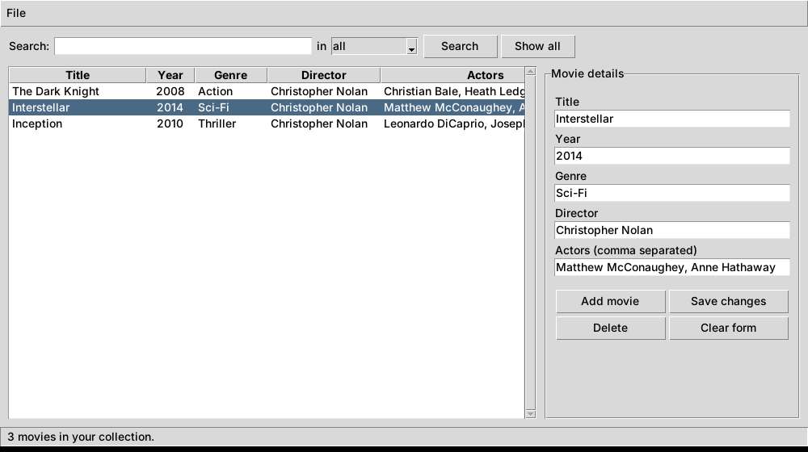

# 🎬 Movie Manager

A simple Python app to manage your movie collection. You can add, edit, delete, search, save and load movies, either from a **desktop window** or from a **text menu in the terminal**.



## Features

- **Add** movies with title, year, genre, director and actors
- **Edit** any field, including the title
- **Delete** movies, with a confirmation step
- **Search** by title, genre, director, actor or year (partial and case-insensitive)
- **Sort** the table by clicking a column heading
- **Save / Open** your collection as a JSON file (`Ctrl+S` / `Ctrl+O`)
- Warns you about unsaved changes before closing
- Input checks: the year must be a valid number, titles can't be empty or duplicated

## Requirements

- Python 3.8 or newer
- No extra packages. The interface uses **Tkinter**, which comes with Python.
  - On some Linux systems, install it with `sudo apt install python3-tk`

## How to run

```bash
git clone https://github.com/<your-username>/movie-manager.git
cd movie-manager

# Desktop interface
python main.py

# Terminal (text menu) version
python main.py --cli
```

Your movies are saved to `movies_file.json` in the project folder, and the app loads that file automatically the next time it starts.

## Project structure

```
movie-manager/
├── main.py                 # Entry point (GUI by default, --cli for the text menu)
├── movie_manager/
│   ├── core.py             # Data logic: add, edit, delete, search, save, load
│   ├── gui.py              # Tkinter desktop interface
│   └── cli.py              # Terminal menu interface
├── tests/
│   └── test_core.py        # Automated tests (pytest)
├── docs/
│   └── screenshot.png
├── requirements-dev.txt
└── .gitignore
```

The logic (`core.py`) is kept separate from the interfaces, so the GUI and CLI share the same code and the logic can be tested on its own.

## Running the tests

```bash
pip install -r requirements-dev.txt
python -m pytest
```

## Possible next steps

- Add a rating or "watched" field
- Import movie details automatically from an online movie database
- Export the collection to CSV
